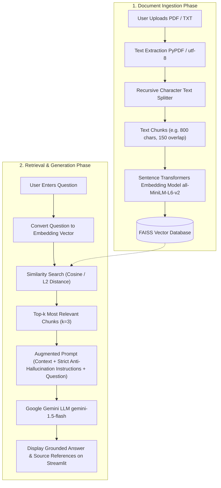

# 📚 AI Document Question Answering System using LLM & RAG

A beginner-friendly, production-ready web application built with **Streamlit**, **LangChain**, **FAISS**, **Sentence Transformers**, and **Google Gemini LLM**. Upload any PDF or TXT file and ask questions grounded strictly in your documents without hallucinations!

---

## 🧠 1. What is RAG and Why Do We Need It?

### The Problem with Standard LLMs
Standard Large Language Models (LLMs) like GPT or Gemini have two major limitations when answering questions about personal or enterprise data:
1. **Knowledge Cutoff**: They only know what was in their training data.
2. **Hallucination**: When an LLM does not know an answer, it often invents plausible-sounding but completely incorrect facts.
3. **No Private Data Access**: They have never seen your confidential PDFs, contracts, manuals, or research papers.

### The RAG Solution (Retrieval-Augmented Generation)
**RAG** connects the LLM to an external knowledge retriever:
Instead of asking the LLM to memorize the entire document, RAG:
1. Searches your document for the **most relevant paragraphs** matching the user's question.
2. Injects those retrieved paragraphs as **context** into the LLM prompt.
3. Instructs the LLM: *"Answer ONLY using this provided context. If the answer is not in the context, say you don't know."*

---

## 🏗️ 2. System Architecture



---

## 📂 3. Project Directory Structure

```
ai-doc-qa-rag/
├── app.py                         # Streamlit interactive web interface
├── rag_pipeline.py                # Core RAG functions: extract, chunk, embed, index, query
├── requirements.txt               # Required Python packages
├── .env.example                   # Environment configuration template
├── .env                           # Local environment file for GOOGLE_API_KEY
├── sample_data/
│   └── artificial_intelligence.txt# Ready-to-use sample document for testing
└── README.md                      # Complete guide & documentation
```

---

## ⚙️ 4. Technical Stack

| Component | Technology | Description |
|---|---|---|
| **Web UI** | Streamlit | Fast, intuitive Python web interface |
| **Framework** | LangChain | Orchestrates document loaders, splitters, vector stores & chains |
| **Embeddings** | Sentence Transformers | Local, free, fast embedding model (`all-MiniLM-L6-v2`) |
| **Vector Store** | FAISS | Facebook AI Similarity Search (fast in-memory vector database) |
| **LLM** | Google Gemini (`gemini-1.5-flash`) | Fast, capable, economical multimodal language model |
| **PDF Extraction** | PyPDF | Pure-Python PDF text extraction library |

---

## 🚀 5. Installation & Execution Guide

### Step 1: Clone or Navigate to the Project
```bash
cd /Users/athulkrishnata/.gemini/antigravity/scratch/ai-doc-qa-rag
```

### Step 2: Create and Activate a Python Virtual Environment
```bash
# Create virtual environment
python3 -m venv venv

# Activate on macOS / Linux:
source venv/bin/activate

# (On Windows use: venv\Scripts\activate)
```

### Step 3: Install Dependencies
```bash
pip install -r requirements.txt
```

### Step 4: Configure Your Gemini API Key
1. Get a free API key from Google AI Studio: [https://aistudio.google.com/app/apikey](https://aistudio.google.com/app/apikey)
2. Open `.env` and paste your key:
   ```env
   GOOGLE_API_KEY=AIzaSy...your_actual_key_here
   ```
*(You can also paste the API key directly into the sidebar in the Streamlit app at runtime).*

### Step 5: Launch the Application
```bash
streamlit run app.py
```
Streamlit will automatically open `http://localhost:8501` in your browser.

---

## 🧪 6. Step-by-Step Testing Walkthrough

1. In the sidebar, upload the provided sample file:
   `sample_data/artificial_intelligence.txt` (or any PDF document of your choice).
2. Click **"🚀 Process Documents"**.
   - Watch the status update to confirm the file was split into chunks and indexed in FAISS.
3. Try asking questions:
   - **Factual Question from Doc**: *"Who organized the Dartmouth conference and who coined the term AI?"*
     - **Result**: The app accurately answers *"John McCarthy, Marvin Minsky, Nathaniel Rochester, and Claude Shannon organized the Dartmouth conference, and John McCarthy coined the term Artificial Intelligence."*
   - **Out-of-Scope Question**: *"What was the weather like in New York yesterday?"*
     - **Result**: The model will strictly reply: *"I could not find the answer to this question in the uploaded document(s)."*
4. Click **"🔎 View Retrieved Context Chunks (Sources)"** to see the exact text snippets retrieved by FAISS that grounded the AI's response.
